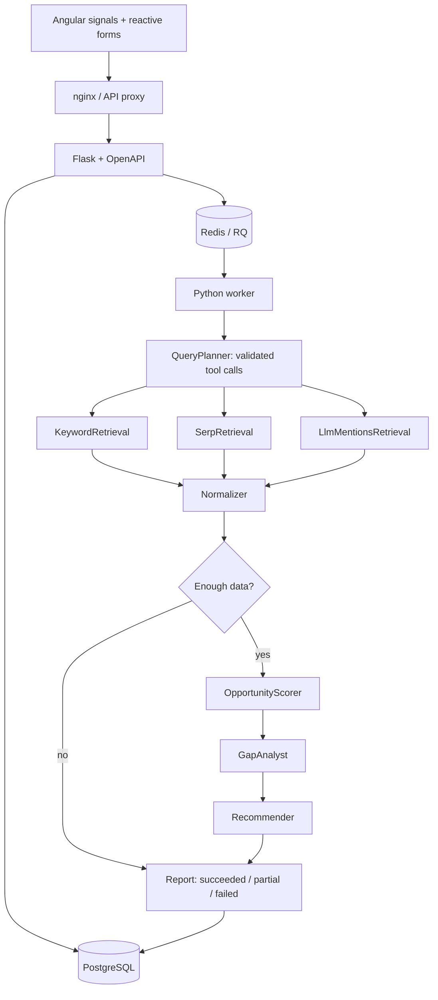

# AI Visibility Platform · Signal

A full-stack assessment for Aegasis Labs. Track a brand across Google organic search,
AI Overviews and indexed LLM mentions; rank measurable content opportunities and turn
them into a content plan. Angular UI, Flask API, LangGraph pipeline, PostgreSQL history,
Redis/RQ jobs and DataForSEO live data.

## Start in under five minutes

Prerequisites: Docker Desktop with Linux containers and Compose. Initial image downloads
can take longer on a slow connection. No host Python or Node installation is required.

```sh
cp .env.example .env
# Set DATAFORSEO_LOGIN / DATAFORSEO_PASSWORD and at least one LLM API key.
# Use a VERIFIED DataForSEO account. Sandbox is also gated by verification.
docker compose up --build
```

- Product: http://localhost:4200
- Swagger: http://localhost:8000/api/docs/swagger
- OpenAPI: http://localhost:8000/api/docs/openapi.json
- Liveness / readiness: http://localhost:8000/healthz and http://localhost:8000/readyz
- API metrics: http://localhost:8000/metrics

The app starts without provider keys so reviewers can inspect setup and failure handling.
An actual analysis needs working credentials. There is no application demo mode or seeded
analytics. Postgres and Redis have **no published host ports**. Migrations run on API startup.
The frontend uses Node 22 to build and nginx to serve; all browser requests use one origin.

```sh
make up       # docker compose up --build
make test     # full backend tests in the api image with real Postgres / Redis
make logs     # follow structured logs
make down     # stop containers, keep volumes
make migrate  # manual migration
```

For frontend development with Node 22.22.3+ in the Node 22 family:
`cd frontend && npm ci && npm start`. The dev server proxies `/api` to port 8000.
`npm run lint`, `npm run build`, and `npm test -- --watch=false` verify the frontend.

## Product walkthrough

1. Open the portfolio and choose **Add a brand**. Enter a name, domain, relevant business
   description, and up to nine competitors. Optional location/language scope the analysis.
2. Open its workspace and choose **Run analysis**. A background job returns immediately.
3. Watch the SSE stage timeline. On interruption the UI falls back to five-second polling.
   The trace shows attempts, timings, dependency failures and the serving LLM provider/model.
4. Explore measured query/channel visibility, observed competitors and cited sources. Missing
   observations are distinct from measured absence. The chart has a text-table alternative.
5. Filter opportunities by query, minimum score, intent or channel; open **Score breakdown**
   to see every deterministic component. Move recommendations through the workflow board.
6. Export CSV/JSON; re-run to preserve a new historical snapshot; compare two runs of the brand.
   A lower opportunity score indicates a smaller remaining gap, but demand/difficulty changes
   can also move it. Failed and partial runs keep their evidence and errors.

The visual direction is documented in `docs/design-direction.md`. Layouts support 1280px and
768px, light/dark appearance, keyboard focus, reduced motion and explicit empty/error states.

## Architecture and agent contracts



| Stage | Responsibility and output |
|---|---|
| QueryPlanner | LLM tool-calling → Pydantic-validated calls; code enforces caps and deduplication |
| KeywordRetrieval | One keyword-ideas request → typed keyword/volume/difficulty data |
| SerpRetrieval | Budgeted SERPs → organic positions, surfaced PAA questions, AI citations |
| LlmMentionsRetrieval | One aggregated request for brand and competitors → indexed LLM evidence |
| Normalizer | Pure parsing and domain/name matching → persisted queries and observations |
| OpportunityScorer | Pure deterministic formula → ranked opportunities and components |
| GapAnalyst | Validated LLM JSON → intent labels and evidence-grounded explanations |
| Recommender | Validated LLM JSON → actionable content titles, outlines and rationale |
| Report | Retained results + stage failures → terminal status and run metrics |

A typed `RunState` carries node outputs. A common wrapper records stage lifecycle, logs and
metrics; exceptions become persisted failures. Partially successful SERP batches keep their
results while marking the stage/run partial. Unvisited stages become skipped. Each execution
thread gets a scoped SQLAlchemy session, rolls back failed transactions, binds trace context
and releases its session. RQ timeout handling and failure/killed-process callbacks record
worker failures. DB brand-row locking serializes active-run checks; queue submission errors
mark the persisted run failed. DB/Redis are not an atomic outbox: see limitations.

## Opportunity definition and formula

An opportunity is a query with demand and a remaining visibility gap, strengthened by evidence
that competitors already appear. This is prioritization, not a promise of traffic or ROI.

```text
demand     = min(1, log10(1 + volume) / log10(1 + 50,000))
visibility = mean(presence over observed channels)
gap        = 1 - visibility
contested  = visible tracked competitors / all tracked competitors
difficulty = keyword_difficulty / 100, else competition, else 0.5
score      = 100 × demand × gap × (0.6 + 0.4 × contested) × (1 - 0.5 × difficulty)
```

Organic presence is 1 for top 3, 0.6 for positions 4–10, 0.2 for 11–20 and 0 beyond.
AI citations/LLM mentions are binary. Available channels have equal weights, defined with
all other constants in `backend/app/scoring/config.py`. Unknown volume contributes zero;
a query without observations currently has visibility zero (a lower-confidence opportunity).
Log scaling prevents high-volume terms dominating; competitor presence supports relevance;
the difficulty penalty reduces speculative work. All components are stored and displayed.
Numbers come from DataForSEO and Python, never an LLM.

## Providers, cost and resilience

`LLM_CHAIN` configures the ordered provider/model chain. Development used
`groq:openai/gpt-oss-120b,gemini:gemini-3.5-flash-lite`. OpenAI and Anthropic are first-class
providers: set their key and corresponding `provider:model` entry to switch. Empty-key
providers are skipped. Model availability and quotas depend on the account.

Agents use `LLMClient.complete_structured` and `call_tools`, with JSON parsing, Pydantic
validation, one repair attempt and ordered fallback. No provider-native strict structured
output feature is required. Successful LLM stages record their actual provider/model.

DataForSEO endpoints (all live by default):

- `/v3/dataforseo_labs/google/keyword_ideas/live`
- `/v3/keywords_data/google_ads/search_volume/live` (standalone tool)
- `/v3/serp/google/organic/live/advanced`
- `/v3/ai_optimization/llm_mentions/search_mentions/live`

Every tool validates arguments before HTTP. The cache key includes provider base URL,
endpoint and canonical request JSON, so **sandbox can never populate the live cache**.
Default TTL is 24 hours. `DATAFORSEO_BASE_URL=https://sandbox.dataforseo.com` is explicit
opt-in development configuration; it is never automatically selected.

`DATAFORSEO_MAX_COST_PER_RUN` defaults to $0.15. Atomic reservations cover in-flight calls
from parallel branches, per physical HTTP attempt. Actual reported costs are counted even
when a task fails. Cache hits are free. One aggregated LLM Mentions call avoids repeated
minimum charges. SERP estimates include depth, paid search operators and async AI Overview;
paid PAA click expansion is disabled because its variable click count prevents a reliable
pre-call bound. Normal surfaced PAA questions are still collected. Pricing estimates follow
[the provider pricing table](https://dataforseo.com/pricing/google-serp/google-organic-serp-api)
and must be reviewed if the provider changes rates; the provider account remains the final
billing authority. The run cost measures DataForSEO charges, excluding LLM provider billing.

External calls have configured timeouts. Retry uses exponential backoff/full jitter for
connection errors, 429, 5xx and retryable inner DataForSEO statuses; Retry-After is honored.
Auth, verification, billing and validation failures do not retry. Circuit breakers fail fast,
then allow one half-open recovery probe. Idempotency keys avoid duplicate run submissions.

## API and persistence

Swagger documents `/api/v1`: brands/competitors CRUD; run create/history/detail/events;
visibility/opportunities/recommendations; status updates; comparison; overview; CSV/JSON export;
and frontend error intake. Responses have request IDs and RFC 7807 error bodies. Brand and
competitor lists use cursor pagination. Run/results views are explicitly capped (100 runs,
200 opportunities), with a null next cursor; full historical pagination is future work.

Profiles, competitors, run snapshots, stage traces, queries, observations, opportunities,
recommendations and cache entries persist in Postgres. Editing a profile never changes an
old run's snapshot. The assessment references a missing “Section 4”; the implementation
assumes all these entities and recommendation status changes must persist across restarts.

## Debug “my run failed yesterday”

1. Open the brand's history and failed run; copy its trace ID. The recorded stages show which
   dependency failed, timing/attempts and which LLM served each completed LLM stage.
2. Fetch `GET /api/v1/runs/<id>` or inspect `docker compose logs worker api`. Filter by run/trace ID;
   correlate the HTTP request ID with queue submission and node/external-call events.
3. Classify the cause: validation/planning, provider quota/auth, account verification, budget,
   transient transport, database or worker failure. Repeating an auth/verification failure wastes time.
4. Confirm `/readyz`, queue/worker health, provider account state and remaining balance. Repair
   the cause, then start a new run; keep the original trace as evidence.

Real excerpt from `docs/sample-trace.log` (2026-11-10; earlier live run):

```json
{"node":"query_planner","event":"node_succeeded","duration_ms":2131,"trace_id":"78adb177-d81f-4cd2-8b67-29a1c402ec1d"}
{"dependency":"dataforseo","event":"external_call_non_retryable","trace_id":"78adb177-d81f-4cd2-8b67-29a1c402ec1d"}
{"node":"keyword_retrieval","event":"node_failed","error_type":"StageFailedError","duration_ms":596,"trace_id":"78adb177-d81f-4cd2-8b67-29a1c402ec1d"}
```

The full original lines are in the trace file. The real provider returned HTTP 403 / 40104
(account verification required); Groq planning succeeded, search data was unavailable and
the run ended failed with zero DataForSEO spend. This is a real failure, not a success fixture.

To deliberately exercise a SERP outage for an existing brand, run this **one-off process**:

```sh
docker compose run --rm -e DEMO_FAIL_SERP=true api python -m app.pipeline.failure_demo BRAND_UUID
```

Normal workers remain unchanged. Other provider calls remain real and budgeted; use a verified
account for meaningful partial results. CI separately runs an automated mocked-provider pipeline
failure test and uploads its actual emitted logs as the `simulated-failure-trace` artifact.
Mocks exist only in automated tests. This one-off live demonstration has not been run from
the Codex sandbox because Docker engine access was denied.

Logs are structured JSON with request/run/trace/node context. Frontend server errors and global
errors report to a bounded, rate-limited endpoint. Optional Sentry is enabled by `SENTRY_DSN`.
API Prometheus metrics are exposed at `/metrics`; pipeline metrics are per worker process and
are not currently aggregated into the API registry. Per-run persisted metrics remain available.

## Verification and CI

`.github/workflows/ci.yml` runs frontend formatting/tests/build plus a **fresh full Docker stack**,
backend lint, regression tests against real Postgres/Redis, a keyless graceful-failure smoke flow,
SPA/deep-link checks and the simulated-failure log capture. No real provider secrets are needed.

Local Codex verification: frontend production build and formatting passed; 14 frontend tests
passed. Python 3.12 dependency-isolated tests covered scoring, budgeting/concurrency, charged
failures, cache namespaces, LLM validation/fallback, planner caps, pricing, SSE cleanup and
circuit recovery (27 tests). Backend lint, syntax and Compose configuration checks passed.
Browser checks against the existing backend created Linear with two competitors, exercised
form validation, existing failed-run results/trace and comparison/history empty states, and
reviewed 1280px/768px in light and dark mode. Screens contain only actual API data.

Current full integration status is visible in the repository's Actions tab. Local Docker build,
`make test` and a container clean-checkout run were blocked by the Codex desktop sandbox's
Docker named-pipe permissions, so their execution is delegated to the committed CI workflow.
The running local backend still uses the previous image until rebuilt; the Angular developer
server on port 4200 uses the new frontend. Latest live account check: 403/40104, $0 cost, $1 balance.

## Trade-offs and limitations

- A small Flask/RQ system is explainable and sufficient for this assessment; no authentication,
  multi-tenancy, deployment hardening or production access control is included. Keep local.
- PostgreSQL is the only supported test DB; native JSONB/UUID behavior matters more than an
  in-memory substitute. Database-dependent tests initialize their disposable DB on demand.
- Provider-specific response parsing remains defensive. AI Overview/PAA parsing and populated
  success/partial screens still need validation with a successful live run after account verification.
- A score based on missing observations is lower confidence. Future work should show coverage
  confidence explicitly and avoid treating unavailable channels as measured absence.
- DB commit and Redis enqueue are separate. Enqueue errors are persisted and killed-job callbacks
  handle work-process failures, but a transactional outbox and stale-run reconciliation are needed
  for complete recovery if the entire worker host disappears. Queue depth is not a job scheduler.
- Prometheus requires a multiprocess/exporter design for combined pipeline metrics. Run-level
  persisted traces work now. List caps, N+1 overview queries and API pagination need scaling work.
- Budget limits depend on provider pricing/response accuracy; add account-level caps and cost
  reconciliation for production. The LLM chain may omit requested tool calls; absent observations
  and skipped/empty stages remain visible rather than fabricating results.

## AI tools used

Claude Code (Anthropic) was used for scaffolding, backend implementation and tests. OpenAI Codex
continued frontend implementation, verification, hardening, CI and documentation. Both operated
under the author's direction and review. The author remains responsible for understanding and
defending the design. See `docs/interview-cheat-sheet.md` for a concise interview reference.
